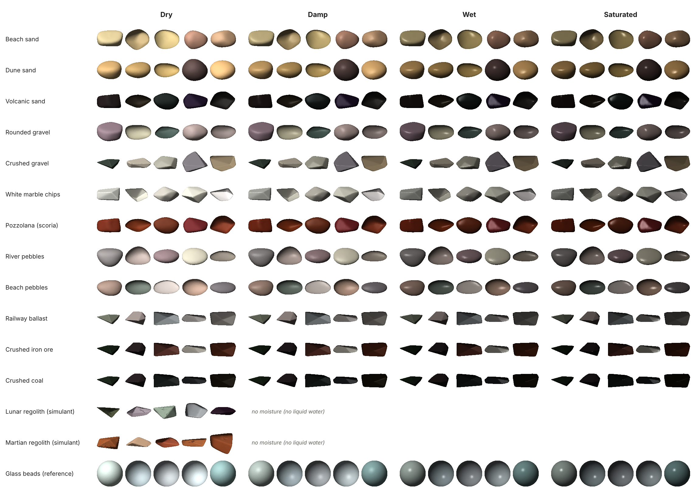

# Granulat

Procedural granular materials for simulation: realistic grains instead of
perfect spheres, exported to **OpenUSD** with physical properties.
Everything runs on CPU.



*Five different grains of each of the 15 presets, dry, damp, wet and
saturated, rendered from the generated meshes. Each grain is drawn at its own
scale: sizes range from 0.07 mm (lunar regolith) to ~5 cm (river pebbles).
Regenerate with `granulat render-gallery` (see Usage).*

## What it does

- Generates *N* distinct grain shapes (100 by default) from distributions
  borrowed from sedimentology: size on the phi scale (Wentworth), Zingg ratios
  (elongation I/L, flatness S/I), angularity and mineralogy.
- Places each shape *k* times (5 by default) in shuffled order with random
  orientations: 500 grains per scene.
- **Measures** every generated grain (nominal diameter, Zingg ratios, Wadell
  sphericity, convexity, angularity proxy) instead of trusting the inputs.
- Exports an OpenUSD scene: prototypes, grains by reference, UsdPreviewSurface
  materials, `UsdPhysics` rigid bodies (mass from volume and density,
  convex-hull collision, friction, restitution) and a collision ground.
- Optionally gives every grain a moisture state through an OpenUSD variant set.

## Installation

```bash
python -m venv .venv && source .venv/bin/activate
pip install -e ".[render]"        # add ",dev" for tests and linting
```

Requires Python 3.10+.

## Usage

```bash
granulat list
granulat generate --preset beach_sand --shapes 100 --copies 5 --seed 1
granulat generate --preset beach_pebbles --moisture --moisture-weights 0,20,50,30
granulat generate --preset rounded_gravel --no-size --no-orientation
granulat render output/beach_sand output/crushed_gravel
granulat render-moisture output/beach_pebbles output/crushed_gravel output/beach_sand
granulat render-gallery output/beach_sand output/crushed_gravel --grains 5
```

The README gallery comes from generating every preset with `--moisture`, then
`granulat render-gallery` on all 15 output folders in category order, with
`--output docs/images/moisture_gallery.png`.

`python -m granulat ...` works too. From Python:

```python
from granulat import Variations, generate_scene, write_outputs

scene = generate_scene("beach_sand", shapes=100, copies=5, seed=1,
                       variations=Variations(moisture=True))
write_outputs(scene, "output")
```

### Presets

| Category | Presets |
|---|---|
| Sand | `beach_sand`, `dune_sand`, `volcanic_sand` |
| Gravel | `rounded_gravel`, `crushed_gravel`, `marble_chips`, `pozzolana` |
| Pebbles | `river_pebbles`, `beach_pebbles` |
| Industrial | `railway_ballast`, `iron_ore`, `coal` |
| Space | `lunar_regolith`, `martian_regolith` (no moisture) |
| Reference | `glass_beads`: exact spheres, the baseline to compare real grains against |

Values are realistic orders of magnitude, not measurements of a specific deposit.

### Variations (checkboxes)

| Option | On | Off |
|---|---|---|
| `--size` | diameter drawn from the grading curve | all at d50 |
| `--shape` | elongation / flatness drawn | mean values |
| `--roundness` | facets and edge rounding drawn | median values |
| `--mineralogy` | mineral and tint drawn | dominant mineral |
| `--orientation` | random orientation | all aligned |
| `--moisture` (off by default) | variant set + state drawn per grain | no moisture |

Turning one variation off does not change the other random draws: with the
same seed you compare the same scene with a single difference.

### Moisture (OpenUSD variant set)

Every prototype carries a `moisture` variant set (`dry`, `damp`, `wet`,
`saturated`) and every grain selects its own. A state changes:

- **mass**: absorbed water plus a surface film, capped by the pore water of a
  heap. Median water content of a beach-sand grain: 3.6 / 14 / 24 %; of a
  crushed-gravel grain: 0.5 / 1.6 / 2.4 %;
- **appearance**: darker colour, lower roughness, clearcoat (UsdPreviewSurface);
- **contact**: friction and restitution (one UsdPhysics material per state),
  plus capillary cohesion in the custom attribute `granulat:capillaryCohesion`,
  since UsdPhysics has no standard schema for it.

In usdview or Omniverse, change a grain's state by changing its variant
selection. Blender's USD importer takes the state selected at import time.
Contact and cohesion coefficients are indicative and still need calibrating.

## Outputs (per preset, under `output/<preset>/`)

| File | Content |
|---|---|
| `granulat_<preset>.usdc` | OpenUSD scene (Blender: File > Import > USD) |
| `prototype_metrics.csv` | measured descriptors, mass (per moisture state), parameters |
| `instances.csv` | grain → shape, position, moisture state |
| `summary.json` | global statistics (d50, mean sphericity, masses, water) |
| `prototypes.npz` | meshes, used by the renderer |
| `shape_sheet.png`, `mix_preview.png` | previews (`granulat render`) |

## Method in brief

1. Build a random convex polyhedron: the hull of points drawn on an ellipsoid
   with Zingg proportions. Few facets give an angular grain.
2. Round edges and corners by replacing the *max* in the polyhedron's gauge
   with a p-norm. Low p gives a rounded grain, high p sharp edges.
3. Add light surface roughness, then scale to the target nominal diameter.

## Physics limits by grain size

Grains are generated at their **real size**. That is right for rendering and
perception, but many of them are too small or too light for today's
rigid-body engines with default settings. Rules of thumb behind the table:

- **Bullet** (PyBullet, Blender) works best with objects larger than ~0.1 m,
  and Blender's default collision margin is 0.04 m.
- **PhysX** (Isaac Sim, Omniverse) uses a default `contactOffset` of 0.02 m
  per shape at metric scale, so two shapes are treated as touching from ~4 cm.
- **Tunnelling**: at 60 Hz, a grain falling at 1–2 m/s travels 1.7–3.3 cm per
  step and can pass through surfaces smaller than that without CCD or substeps.
- **Mass ratio**: iterative solvers become unstable when very light grains
  touch a much heavier body, such as a robot foot weighing a few kilograms.

| Physics risk | Presets (median size · mean grain mass) | What to do |
|---|---|---|
| **Not usable as individual rigid bodies** | `lunar_regolith` (0.07 mm · ~6 µg), `martian_regolith` (0.13 mm · ~39 µg), `dune_sand` (0.22 mm · ~18 µg), `beach_sand` (0.36 mm · ~90 µg), `volcanic_sand` (0.53 mm · ~0.4 mg), `glass_beads` (1 mm · ~1.4 mg) | Use for rendering and perception; for physics, use a continuum model (MPM), a deformable heightfield, or scaled-up grains |
| **Unstable without tuning** | `rounded_gravel` (5.8 mm · ~0.4 g), `crushed_gravel` (8.1 mm · ~0.8 g) | Reduce contact offsets / margins to ~1 mm, enable CCD, use substeps or a smaller time step |
| **Workable with tuning** | `marble_chips` (11 mm · ~2.4 g), `pozzolana` (12 mm · ~1.5 g, very light), `iron_ore` (16.5 mm · ~20 g) | Same settings as above; check stability against the heaviest body in contact |
| **Generally fine** | `coal` (23 mm · ~17 g), `beach_pebbles` (39 mm · ~130 g), `railway_ballast` (40 mm · ~100 g), `river_pebbles` (49 mm · ~260 g) | Keep CCD on for impacts; in Blender, lower the default 0.04 m margin |

These are orders of magnitude, not hard limits: the actual threshold depends
on the engine, time step, solver iterations, contact settings and the bodies
in contact. Scaling grains up changes the physics (mass, inertia, contact
forces scale differently), so treat it as an approximation of the material.

**Perception is not affected.** Cameras and renderers have no minimum size:
every preset, including sand and regoliths, can be used at real scale for
synthetic images, ground-truth masks, grading-from-image benchmarks or
appearance studies (moisture darkening and gloss). Only dynamics need the
precautions above. A thin layer of a few hundred grains on a hard surface
(the "sand on the ramp" case) is also within reach of rigid-body engines for
the gravel and pebble presets.

## Known limits

- **Real units.** See *Physics limits by grain size* above.
- **No grain-by-grain physics at large scale.** CPU physics targets a few
  hundred grains; instancing is for rendering surfaces.
- **Angularity is a proxy**, not Wadell roundness, and is only comparable
  between grains of the same mesh resolution.
- **Convex grains only**: no fractures or concave shells yet.

## Development

```bash
pip install -e ".[dev]"
pytest            # test suite
ruff check .      # lint
ruff format .     # format
```

### Commits and versions

- Commit messages follow [Conventional Commits](https://www.conventionalcommits.org/)
  (`feat:`, `fix:`, `docs:`, `test:`, `refactor:`, `build:`, `chore:`).
- Versions follow [Semantic Versioning](https://semver.org/). The version
  lives in one place, `pyproject.toml`; `granulat.__version__` reads it from
  the installed package metadata.
- To release: update `version` in `pyproject.toml`, move the `Unreleased`
  entries of `CHANGELOG.md` under the new version with its date, commit as
  `chore(release): X.Y.Z`, then tag `vX.Y.Z` (annotated).
