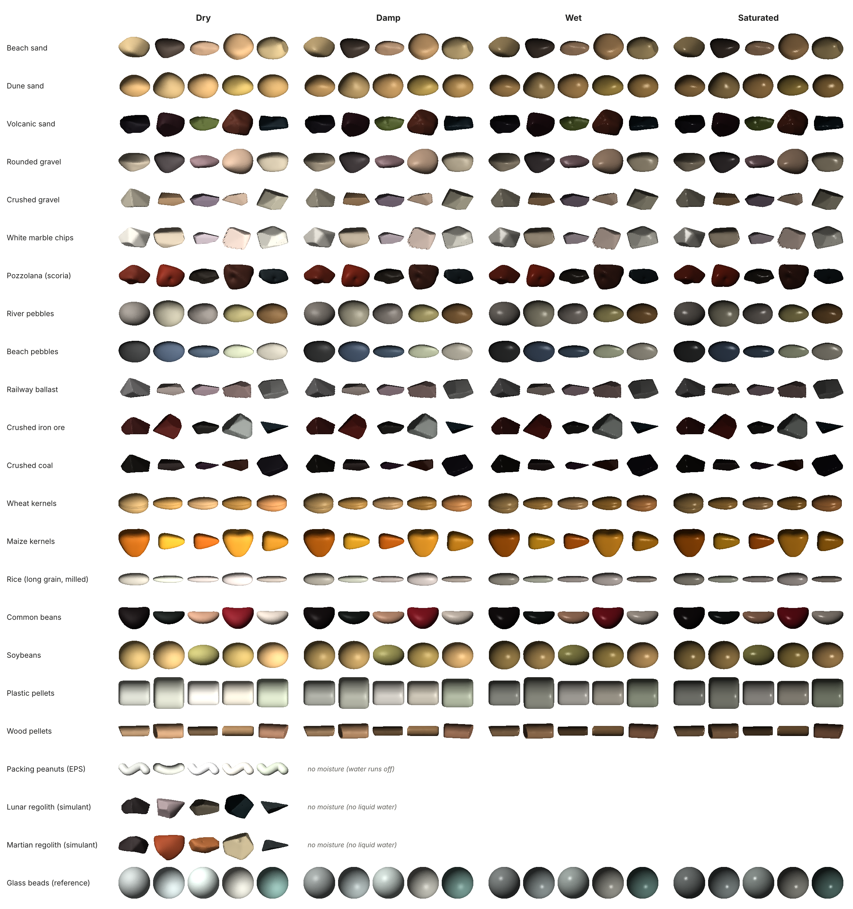

<h1 align="center">
  <picture>
    <source media="(prefers-color-scheme: dark)" srcset="https://raw.githubusercontent.com/drscaon/granulaire/main/docs/images/logo-dark.svg">
    
  </picture>
</h1>

<p align="center"><strong>Realistic granular assets generator for Physical AI.</strong></p>

<p align="center">
  <a href="https://github.com/drscaon/granulaire/actions/workflows/ci.yml"></a>
  <a href="https://pypi.org/project/granulaire/"></a>
  
  
  <a href="https://primvaria.com"></a>
</p>

Granulaire generates sand, gravel, pebbles, seeds, fruit, pellets, rubber mulch and packing peanuts
with realistic, measured shapes, sizes, masses and moisture, and exports them
to **OpenUSD**. It is built for **Physical AI**: robots trained and tested in
simulation (reinforcement learning, virtual test campaigns, sim-to-real) need
ground that looks and behaves like the real thing, not perfect spheres, and
perception models need synthetic images with exact ground truth. Every preset is
checked in **MuJoCo** and in **Blender** (a pile of grains, read back from the
file) and passes OpenUSD's own validators. Everything
can run on CPU; see [Physics limits by grain size](https://github.com/drscaon/granulaire/blob/main/docs/physics.md#physics-limits-by-grain-size)
for what current engines can simulate.

Granulaire is part of [**Primvaria**](https://primvaria.com), with
[Maillage](https://github.com/drscaon/maillage) (textiles),
[Filaire](https://github.com/drscaon/filaire) (cables) and
[Quincaillerie](https://github.com/drscaon/quincaillerie) (fasteners, cells
and holders), and follows the same approach: distributions instead of one
shape, measured outputs, honest limits.



*Five different grains of each of the 25 presets, dry, damp, wet and
saturated, rendered from the generated meshes. Each grain is drawn at its own
scale: sizes range from 0.07 mm (lunar regolith) to ~5 cm (river pebbles).
Regenerate with `granulaire render-gallery` (see Usage).*

## What it does

- Generates *N* distinct grain shapes (100 by default) from distributions
  borrowed from sedimentology: size on the phi scale (Wentworth), Zingg ratios
  (elongation I/L, flatness S/I), angularity, irregularity (fracture faces,
  lumps, pits) and mineralogy. Kernels, seeds and pellets use their own shape
  families (superellipsoids, cylinders).
- Places each shape several times in shuffled order with random orientations:
  by default 100 shapes × 5 copies = 500 grains per scene (see
  [Scene size and mixing](https://github.com/drscaon/granulaire/blob/main/docs/usage.md#scene-size-and-mixing)).
- **Measures** every generated grain (nominal diameter, Zingg ratios, Wadell
  sphericity, convexity, angularity proxy) instead of trusting the inputs.
- Exports an OpenUSD scene: prototypes, grains by reference, UsdPreviewSurface
  materials, `UsdPhysics` rigid bodies (mass from volume and density,
  convex-hull collision, friction, restitution) and a collision ground.
- Optionally gives every grain a moisture state through an OpenUSD variant set.
- **Tests every preset in MuJoCo and Blender** (`granulaire sim-test`,
  `granulaire blender-test`): a pile of grains read back from the file falls
  and must settle; see [Physics checks](https://github.com/drscaon/granulaire/blob/main/docs/physics.md#physics-checks).
- Exports packing peanuts and cherry tomatoes as rigid bodies like the other
  grains, plus a layer over the file that makes them deformable bodies.
  **Deformable simulation works only with NVIDIA OmniPhysics** (Omniverse,
  Isaac Sim 5+) and is **not tested yet**; see
  [Deformable grains](https://github.com/drscaon/granulaire/blob/main/docs/usage.md#deformable-grains-packing-peanuts-cherry-tomatoes).

## Engines

Every file is OpenUSD with standard `UsdPhysics` schemas. Where each engine
stands, as on the [Primvaria engine matrix](https://primvaria.com/#engines):

| Engine | Status |
|---|---|
| OpenUSD validators (`usdchecker`) | **tested**: every preset, every moisture state, in CI |
| Blender | **tested**: pile test of every preset, through Blender's USD importer (`granulaire blender-test`) |
| MuJoCo | **tested**: pile test of every preset, model built from the file (`granulaire sim-test`) |
| NVIDIA Isaac Sim (PhysX) | not tested yet (needs an NVIDIA RTX GPU); standard `UsdPhysics` rigid bodies |
| NVIDIA OmniPhysics deformables | packing peanuts and cherry tomatoes exported as a layer over the file, structure checked, not simulated yet |

## Installation

From PyPI:

```bash
pip install "granulaire[render]"
pip install "granulaire[sim]"     # MuJoCo pile test
pip install "granulaire[blender]" # Blender as a Python module (Python 3.13), for the Blender pile test
```

From a clone, for development:

```bash
python -m venv .venv && source .venv/bin/activate
pip install -e ".[render]"        # add ",dev" for tests and linting
```

Requires Python 3.11+ and `usd-core` 26.5+ (the OpenUSD bindings).

Earlier `usd-core` wheels generate the same files, but their OpenUSD
validators do not load (25.5 ships without the validator
libraries, 25.8 and 25.11 without the UsdPreviewSurface definitions), and CI
tests both 26.5 and the newest release.

## Usage

```bash
granulaire list
granulaire generate --preset beach_sand          # 100 shapes × 5 copies, shuffled
granulaire generate --preset beach_sand --shapes 20 --copies 10 --no-shuffle --seed 3
granulaire generate --preset beach_pebbles --moisture --moisture-weights 0,20,50,30
granulaire generate --preset rounded_gravel --no-size --no-orientation
granulaire render output/beach_sand output/crushed_gravel
granulaire render-moisture output/beach_pebbles output/crushed_gravel output/beach_sand
granulaire render-gallery output/beach_sand output/crushed_gravel --grains 5
```

The README gallery comes from generating every preset with `--moisture`, then
`granulaire render-gallery` on all 25 output folders in category order, with
`--output docs/images/moisture_gallery.png`.

`python -m granulaire ...` works too. From Python:

```python
from granulaire import Variations, generate_scene, write_outputs

# defaults: 100 shapes × 5 copies, shuffled, seed 1; moisture turned on
sand = generate_scene("beach_sand", variations=Variations(moisture=True))
write_outputs(sand, "output")  # -> output/beach_sand/

# 20 shapes × 10 copies, copies side by side, another random draw
gravel = generate_scene("crushed_gravel", shapes=20, copies=10, shuffle=False, seed=3)
write_outputs(gravel, "output")  # -> output/crushed_gravel/
```

Four short scripts in [`examples/`](https://github.com/drscaon/granulaire/tree/main/examples)
show the rest, each explained by its own comments: a first pack and its
ground truth, one aspect switched off, reading the file with OpenUSD alone,
and the pile test in MuJoCo.

### Variations (checkboxes)

| Option | On | Off |
|---|---|---|
| `--size` | diameter drawn from the grading curve | all at d50 |
| `--shape` | elongation, flatness and irregularity drawn | mean values |
| `--roundness` | facets and edge rounding drawn | median values |
| `--mineralogy` | mineral and tint drawn | dominant mineral |
| `--orientation` | random orientation | all aligned |
| `--moisture` (off by default) | variant set + state drawn per grain | no moisture |

Turning one variation off does not change the other random draws: with the
same seed you compare the same scene with a single difference.

## Outputs (per preset, under `output/<preset>/`)

| File | Content |
|---|---|
| `granulaire_<preset>.usdc` | OpenUSD scene (Blender: File > Import > USD) |
| `granulaire_<preset>_omniphysics.usdc` | deformable presets only: the same scene with deformable bodies for NVIDIA OmniPhysics (Omniverse, Isaac Sim 5+), a layer over the file, to open instead of it |
| `prototype_metrics.csv` | one row per shape: measured descriptors, mass (per moisture state), parameters |
| `instances.csv` | one row per grain, read back from the file: its identity, its classes (the [semantic labels](https://github.com/drscaon/granulaire/blob/main/docs/openusd.md) renderers turn into segmentation masks), **every drawn value** (`variation:<name>`) and **every measured value** (`measured:<name>`), then its prototype and position: the ground truth |
| `manifest.json` | what the pack is (contract, generator, version, preset, seed, aspects, files) and its summary: global statistics (d50, mean sphericity, masses, water) and `grading`, the sizes against the preset's curve (see [Limits](https://github.com/drscaon/granulaire/blob/main/docs/limits.md#limits)) |
| `prototypes.npz` | meshes, used by the renderer |
| `shape_sheet.png`, `mix_preview.png` | previews (`granulaire render`) |

## Limits

The short version; the full list is in [Limits](https://github.com/drscaon/granulaire/blob/main/docs/limits.md).

- Values are sensible centres to randomise around, not calibrated measurements:
  **no angle of repose is verified** for any preset.
- Physics on CPU targets a few hundred grains, with convex-hull collision.
- Wet grains differ by friction, restitution and mass only: no capillary cohesion.
- Deformable grains need NVIDIA OmniPhysics and are **not tested yet**.

## Development

```bash
git clone https://github.com/drscaon/granulaire.git && cd granulaire
pip install -e ".[dev]"
pytest
```

Conventions and continuous integration: [Development](https://github.com/drscaon/granulaire/blob/main/docs/development.md).

## Documentation

| Page | What it holds |
|---|---|
| [Usage in depth](https://github.com/drscaon/granulaire/blob/main/docs/usage.md) | Scene size and mixing, the preset list, moisture states, deformable grains, opening a scene in Blender. |
| [OpenUSD layout and contract](https://github.com/drscaon/granulaire/blob/main/docs/openusd.md) | The ground and physics scene, OpenUSD compliance, and what the Primvaria contract writes on every grain. |
| [Physics: method, values and checks](https://github.com/drscaon/granulaire/blob/main/docs/physics.md) | How shapes are made, the friction and restitution table, the pile tests in MuJoCo and Blender, and what changes with grain size. |
| [Limits](https://github.com/drscaon/granulaire/blob/main/docs/limits.md) | Everything Granulaire does not do or has not verified, stated plainly. |
| [Development](https://github.com/drscaon/granulaire/blob/main/docs/development.md) | Setting up, commit and branch conventions, continuous integration. |

## License

[MIT](https://github.com/drscaon/granulaire/blob/main/LICENSE) © 2026 Daniel Régis Sarmento Caon

The logo is set in IBM Plex Sans (SIL Open Font License 1.1), outlined into
paths, so it displays without the font installed.

---

Granulaire is part of [**Primvaria**](https://primvaria.com), physics-ready variability for Physical AI, in OpenUSD: `pip install primvaria` installs the whole suite ([source](https://github.com/drscaon/primvaria)).
