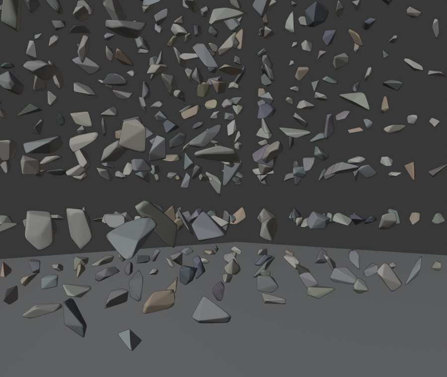
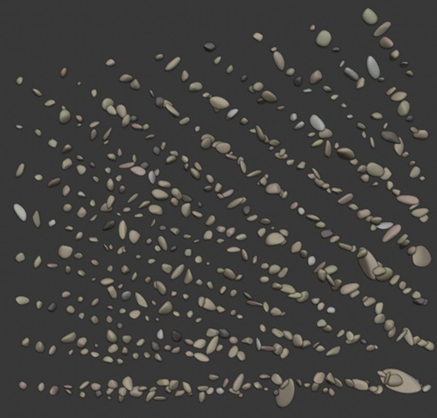

# Usage in depth

Scene size and mixing, the preset list, moisture states, deformable grains, opening a scene in Blender.

Part of the [Granulaire](../README.md) documentation.

## Scene size and mixing

| Option (CLI / Python) | Default | Effect |
|---|---|---|
| `--shapes N` / `shapes=N` | 100 | number of distinct grain shapes |
| `--copies K` / `copies=K` | 5 | how many times each shape is placed; the scene has N × K grains |
| `--no-shuffle` / `shuffle=False` | shuffled | place the copies of each shape side by side, shape after shape, instead of mixing them, e.g. to compare shapes |
| `--seed S` / `seed=S` | 1 | random seed; the same options and seed give the same scene |

`--shapes` and `--copies` must be at least 1. Turning shuffling off changes
only which shape goes in which slot: shapes, positions and orientations stay
the same.

## Presets

| Category | Presets |
|---|---|
| Sand | `beach_sand`, `dune_sand`, `volcanic_sand` |
| Gravel | `rounded_gravel`, `crushed_gravel`, `marble_chips`, `pozzolana` |
| Pebbles | `river_pebbles` (rounded, equant, earthy mixed minerals), `beach_pebbles` (flat discs and ovals, polished basalt and marble) |
| Industrial | `railway_ballast`, `iron_ore`, `coal`, `rubber_mulch` (shredded recycled tyres: torn, grippy, bouncy nuggets) |
| Agricultural | `wheat` (kernels with a ventral crease), `maize` (wedge-shaped dent kernels), `rice` (long grain, milled), `beans` (kidney-shaped, mixed varieties), `soybean`, `cherry_tomatoes` (glossy skin, stem scar): **deformable, NVIDIA OmniPhysics only** (rigid elsewhere with `--no-deformable`), **no moisture** (waxy skin) |
| Pellets | `plastic_pellets` (PE/PP, ~3.4 mm), `wood_pellets` (6 mm diameter, 10–30 mm long, broken ends) |
| Packaging | `packing_peanuts` (expanded polystyrene, S or C shaped): **deformable, NVIDIA OmniPhysics only** (rigid elsewhere with `--no-deformable`), and **no moisture**: EPS never gets wet, water runs off |
| Space | `lunar_regolith`, `martian_regolith` (no moisture) |
| Reference | `glass_beads`: exact spheres, the baseline to compare real grains against |

Values are realistic orders of magnitude, not measurements of a specific deposit.

## Moisture (OpenUSD variant set)

Every prototype carries a `moisture` variant set (`dry`, `damp`, `wet`,
`saturated`) and every grain selects its own. A state changes:

- **mass**: a wetter grain is **heavier**. Each state stores its own mass
  (dry mass + water) in `physics:mass`, plus the water alone in
  `granulaire:waterMass`; switching the variant switches the mass;
- **appearance**: darker colour, lower roughness, clearcoat (UsdPreviewSurface);
- **contact**: friction and restitution (one UsdPhysics material per state),
  plus capillary cohesion in the custom attribute `granulaire:capillaryCohesion`,
  since UsdPhysics has no standard schema for it.

The water comes from two sources: a **surface film**, which weighs a lot on
small grains (much surface for little mass) and little on pebbles, capped by
the water the pores of a heap can hold; and **absorbed water**, which
dominates for porous stone (pozzolana) and for anything that soaks
(seeds, beans, wood). Median weight gain of one grain, % of its dry mass:

| Material | Damp | Wet | Saturated |
|---|---|---|---|
| Beach sand | +3.6 % | +14 % | +24 % |
| Pozzolana (porous) | +6.2 % | +17 % | +22 % |
| Crushed gravel | +0.5 % | +1.5 % | +2.2 % |
| River pebbles | +0.2 % | +0.6 % | +0.8 % |
| Beach pebbles (dense basalt, marble) | +0.1 % | +0.3 % | +0.5 % |
| Plastic pellets | +1.0 % | +4.0 % | +7.0 % |
| Wheat | +9.6 % | +26 % | +34 % |
| Soybeans | +12 % | +34 % | +43 % |
| Wood pellets | +15 % | +41 % | +52 % |
| Common beans | +27 % | +73 % | +92 % |

Every preset's values are in `manifest.json` (`median_water_content_pct`, in
its summary) and per grain in `instances.csv` (`measured:mass_<state>_kg`).

- **No swelling.** A wet grain gets heavier but keeps its shape and size. In
  reality beans, seeds and wood pellets swell when soaked, so their wet
  density is overstated.
- **Indicative values.** Water contents, contact and cohesion coefficients
  are model orders of magnitude, not measurements, and still need
  calibrating.

In usdview or Omniverse, change a grain's state by changing its variant
selection. Blender's USD importer takes the state selected at import time.

Presets with no moisture states, even with `--moisture`: the regoliths (no
liquid water), the polystyrene packing peanuts (EPS never gets wet: water
runs off) and the cherry tomatoes (water beads on the waxy skin).

## Deformable grains (packing peanuts, cherry tomatoes)

> **Works only with NVIDIA OmniPhysics, and not tested yet.** Deformable
> simulation of `packing_peanuts` and `cherry_tomatoes` requires an engine that
> reads NVIDIA's OmniPhysics deformable schema: Omniverse Kit and Isaac Sim 5 or
> later, where PhysX runs it on the GPU. Everything else (Blender, usdview,
> MuJoCo, Bullet, engines reading only standard UsdPhysics) reads the file
> itself, where these grains are **ordinary rigid bodies**.
>
> Granulaire is developed without an NVIDIA GPU: the files are checked to be
> valid OpenUSD with the documented schemas and attributes, but they have
> **never been simulated in Isaac Sim**. In some releases the schema is a beta
> feature that must be enabled. Feedback from anyone who runs them is very
> welcome.

Why: core OpenUSD has no deformable-body schema yet. UsdPhysics covers rigid
bodies only ([UsdPhysics overview](https://openusd.org/dev/api/usd_physics_page_front.html));
the AOUSD Physics Working Group lists deformable and soft bodies only as a
possible future extension
([charter](https://project.linuxfoundation.org/hubfs/AOUSD/Charters/24.12.16%20AOUSD%20Physics%20Working%20Group%20Charter%20-%20Approved.pdf)).
The file `granulaire_<preset>.usdc` therefore holds plain OpenUSD and
`UsdPhysics` only, with these grains as rigid bodies. What makes them
deformable follows NVIDIA's **OmniPhysics deformable schema**
([reference](https://docs.omniverse.nvidia.com/kit/docs/omni_physics/latest/dev_guide/deformables/deformable_bodies.html)),
built on the core `UsdGeom.TetMesh`, and is written as a layer over the file,
`granulaire_<preset>_omniphysics.usdc`. Open the layer instead of the file
(Isaac Sim: File > Open) and each grain becomes:

```
/World/Prototypes/Grain_000   Xform  + OmniPhysicsDeformableBodyAPI (omniphysics:mass)
                                     - PhysicsRigidBodyAPI, PhysicsMassAPI (removed by the layer)
  geom                        Mesh   + OmniPhysicsDeformablePoseAPI:custom (bind pose)
  collision                   the rigid collider, deactivated by the layer
  sim                         TetMesh + OmniPhysicsVolumeDeformableSimAPI
                                      + OmniPhysicsDeformablePoseAPI:custom
                                      + PhysicsCollisionAPI
/World/Looks/Soft             Material + OmniPhysicsBaseMaterialAPI (density, friction)
                                       + OmniPhysicsDeformableMaterialAPI
                                         (Young's modulus, Poisson's ratio)
                                       + PhysxDeformableMaterialAPI
                                         (elasticity damping)
```

The layer has the file as its only sublayer. `python -m granulaire.omniphysics
<folder>` checks its structure (every grain deformable and no longer rigid,
simulation mesh and rest shape, mass equal to the file's, deformable
material); the OpenUSD validators run on it in CI.

- The simulation mesh fills the grain's volume with tetrahedra (voxels split
  into 6 tetrahedra each, ~1,300–1,400 per grain); the render mesh follows it
  through the bind pose. The tetrahedral volume matches the surface within a
  few percent.
- The schemas are applied by name, so the layer stays valid OpenUSD in any
  tool, but only OmniPhysics acts on them. `usd-core` does not list
  unregistered schemas in `GetAppliedSchemas()`, but they are in the file
  (`apiSchemas` metadata).
- NVIDIA's schema is still evolving (it replaced an earlier PhysX deformable
  API); if a newer Omniverse release renames attributes, re-export with an
  updated Granulaire. If OpenUSD standardises deformables, the export will move
  to that schema.
- `--no-deformable` does not write the layer (and skips the tetrahedral meshes).
- **Bounce.** Deformable materials have no restitution: a grain bounces
  through its own elasticity, and `physxDeformableMaterial:elasticityDamping`
  (1/s) sets how much energy each deformation loses. The values below are
  uncalibrated starting points, to tune in Isaac Sim.
- Material values are indicative:

  | Preset | Young's modulus E | Poisson's ratio ν | Elasticity damping |
  |---|---|---|---|
  | `packing_peanuts` (EPS foam) | ≈ 1 MPa | ≈ 0.1 | 0.02 /s |
  | `cherry_tomatoes` (soft fruit, keeps its volume when squeezed) | ≈ 0.5 MPa | ≈ 0.45 | 0.01 /s |

## In Blender

The `.usdc` scene opens directly in Blender (File > Import > USD).

<table>
  <tr>
    <td width="50%"></td>
    <td width="50%"></td>
  </tr>
  <tr>
    <td align="center"><sub>Crushed gravel falling onto the floor (Blender rigid-body physics)</sub></td>
    <td align="center"><sub>Beach sand, rounded grains in mineral colours</sub></td>
  </tr>
</table>

<sub>Screenshots from the first version (0.1.0); grain shapes have become more
varied since then.</sub>
